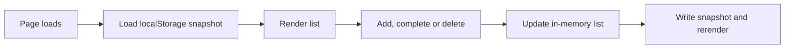

# Review guide: To-Do List — M4

Date: 2026-11-07   Code state: workspace-only; no Git branch or commit exists   Spec: `SPEC.md`

## What this is, in plain language
The page lets you add tasks, mark them complete, and delete them. It saves the list in this browser and uses the local `dark-glass` palette, mesh background, and translucent panel treatment. Lily inspected the local preview after the top-margin fix and confirmed that it works. The desktop/browser automation was unavailable, so the exact viewport, keyboard, reload, and storage-error walkthroughs were not recorded by the agent.

## Start here (30 seconds)
- Entry point: `index.html` — semantic form and list controls; `app.js` connects them to task operations and storage.
- Run it: `python -m http.server 8000` -> open `http://localhost:8000` and add a task.

## Module map

```text
test-todo-list/
  index.html                    Russian task form, empty state, list and feedback regions
  styles.css                    responsive dark-glass mesh, surfaces, controls and focus styles
  app.js                        task operations, localStorage, DOM events and rendering
  tests/smoke.test.js           page asset and heading references
  tests/todo-storage.test.js    storage format and failure behavior
  tests/todo-ui.test.js         pure task state operations
  tests/theme.test.js           kit token presence and conservative text contrast
  docs/                         specs, architecture, decisions, plans and this guide
```

## The files that matter (read in this order)

| # | File | Why it matters | Look for |
|---|---|---|---|
| 1 | `index.html` | Browser entry point | Required IDs and accessible labels/feedback regions. |
| 2 | `app.js` | App behavior | `textContent` rendering, immutable updates, and storage error feedback. |
| 3 | `styles.css` | Visual system and layout | `dark-glass` mesh, translucent panel, small-screen sizing, focus states. |
| 4 | `tests/todo-ui.test.js` | Task transformations | Trim, toggle, delete, and no input mutation. |
| 5 | `tests/todo-storage.test.js` | Persistence behavior | Missing/corrupt data and throwing storage. |
| 6 | `tests/theme.test.js` | Contrast contract | Required tokens and text contrast thresholds. |

Files you can ignore: none in this small project.

## How it flows



## Verify it yourself

| # | Do this | Expect | If it fails, look at |
|---|---|---|---|
| 1 | `node --check app.js` | Exit code 0; no output. | `app.js` |
| 2 | `node --test` | 14 tests pass, 0 fail. | `tests/` |
| 3 | Start `python -m http.server 8000`, then run `python -c "import urllib.request; print(urllib.request.urlopen('http://127.0.0.1:8000/').status); print(urllib.request.urlopen('http://127.0.0.1:8000/app.js').status); print(urllib.request.urlopen('http://127.0.0.1:8000/styles.css').status)"` | Prints `200` three times; stop the server with Ctrl+C. | Server output and current working directory |
| 4 | In a browser, add two tasks, complete one, delete the other, reload, and repeat using only Tab / Enter / Space | Each action works; after reload the remaining task and completion state persist. | `index.html`, `app.js` |
| 5 | Set viewport to 360 px and 1280 px; inspect horizontal scroll and text contrast | No horizontal overflow; body text >= 7:1 and secondary text >= 4.5:1. | `styles.css`, `tests/theme.test.js` |

Rows 4–5 are manual browser checks. Lily confirmed the preview works after the top-margin fix, but did not report the exact viewport/keyboard/storage scenarios. CUA could not capture the Firefox window; Firefox/Edge headless attempts could not start their renderer. The local HTTP responses and Node suite were verified.

## Where the risky bits are
- Writes can fail while the UI still displays the in-memory change; the status region must announce that it may disappear after reload.
- Task titles must be inserted through `textContent`, including text that looks like HTML.
- The glass surface depends on the mesh behind it; contrast needs a browser check over the brightest background region. `body { display: flow-root; }` keeps the page-shell top margin inside the background so the mesh covers the page from the top edge.

## What to try to break it
- Add a task containing ``; it should render as literal text.
- Make browser storage writes fail; the task should remain visible and `#task-feedback` should explain it was not saved.
- Add, complete, and reload a task on the same origin.
- Use keyboard only to add, toggle, and delete a task.

## Known gaps / not proven
- The agent could not independently record the M3 viewport, keyboard, reload, and storage-error walkthroughs because the desktop/browser automation runtime could not capture/control the browser; Lily confirmed the preview works after the layout fix.
- No Git repository or commit exists in the workspace; the authenticated publishing agent will need to initialize or clone the target repository.
- No public GitHub repository or hosted URL exists yet.

## Decisions you may want to revisit
- Static browser app / GitHub Pages target: [ADR-0001](adr/0001-serve-as-a-static-browser-app.md).
- Origin-scoped `localStorage`: [ADR-0002](adr/0002-store-tasks-in-browser-localstorage.md).
